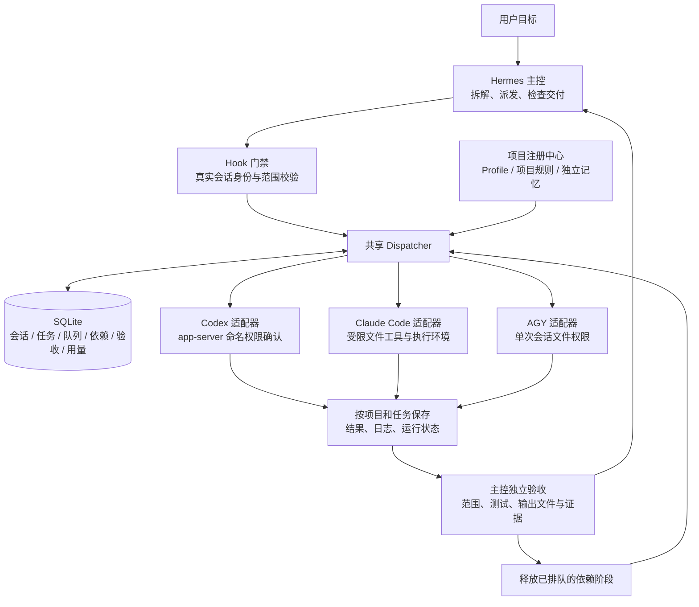

# Hermes Team V8.1

**一套 Hermes，管理多个项目，协调多个 Agent 执行器。**

**[下载 v8.1.1 源码与 Windows 安装向导（ZIP）](https://github.com/dyc19991225/hermes-team-v8/archive/refs/tags/v8.1.1.zip)**

v8.1.1 修复高风险审批、派发恢复、取消状态、向导中断恢复和大日志解析。Windows 隔离测试 **141 项通过**。详见 [版本记录](CHANGELOG.md#v811--2026-11-18) · [Windows 安装说明](docs/windows-setup.md)。

[历史 v8.1.0 Release](https://github.com/dyc19991225/hermes-team-v8/releases/tag/v8.1.0) · [v8.1.0 下载与安装验收结果](https://github.com/dyc19991225/hermes-team-v8/releases/download/v8.1.0/ACCEPTANCE-RESULTS.md) · [v8.1.0 SHA-256 校验文件](https://github.com/dyc19991225/hermes-team-v8/releases/download/v8.1.0/SHA256SUMS.txt)

基于 Hermes 搭建的 Windows 本地 Agent 编排实践：由 Hermes 理解目标、拆分任务、派发执行并检查交付，通过共享 Dispatcher 将 Codex、Claude Code 和 Antigravity CLI（AGY）接入同一套任务协议。

V8 的重点是让多个项目共用工具和登录状态，同时明确每次任务属于哪个项目、能访问哪些文件、如何停止，以及用什么证据判断结果。V8.1 在此基础上修复执行稳定性问题，增加串行队列、阶段依赖、独立验收记录和任务预算。

> 这里公开 V8.1 核心运行源码、Hermes Hook、管理 Skill、配置模板和回归测试。V8.1 是本地编排方案的版本名。实际验收环境为 Windows 与 Python 3.13，真实模型任务需要自行安装并登录 CLI。更新日期 2026-11-18。

[Windows 一键配置](docs/windows-setup.md) · [运行与配置](docs/runtime-setup.md) · [核心源码](dispatch/) · [回归测试](dispatch/tests/) · [架构与执行流程](docs/architecture.md) · [验证记录](docs/validation.md)

## Windows 一键安装配置

适用于 Windows。需要可运行的 Hermes、Codex 原生 `.exe`；Claude Code / AGY 可选。Python 要求 3.13+，未检测到时可确认后用 winget 安装；模型 CLI 未安装时，向导提供官方安装说明和路径重试。ZIP 包含源码与配置向导，不内置模型 CLI 或登录账号。

1. **下载并解压**：[获取 v8.1.1 ZIP](https://github.com/dyc19991225/hermes-team-v8/archive/refs/tags/v8.1.1.zip)，完整解压到与业务项目分开的固定目录。
2. **运行向导**：双击解压目录中的 **`install.cmd`**，检测环境和执行器，选择有效的 Hermes 配置目录，填写业务项目路径与项目 ID。
3. **预览并应用**：确认文件改动后，向导先备份，再合并 Hook、生成管理 Skill 并执行本地自检；保留已有模型、渠道和其他 Hook。
4. **启动并完成信任**：双击 **`start-hermes.cmd`**，在官方界面完成主控模型、账号登录及首次 Hook 信任；以后继续用此文件启动，沿用保存的配置。

若显示 `needs_attention / hook_trust_pending`，表示仍待本人确认 Hook，不能视为全部就绪；向导不会代写信任记录。完整操作及恢复方法见 [向导说明](docs/windows-setup.md)。

## 运行公开测试

在 Windows 上安装 Python 3.13，克隆仓库后执行：

```powershell
python -X utf8 -B scripts/run_tests.py
```

仅使用 Python 标准库。入口将源码与测试复制到临时目录，生成虚构项目及本地 Python 假执行器，用户目录也切换到临时配置；不需要安装模型 CLI 或登录账号，不发起模型请求。

v8.1.1 运行时 **112 项测试通过**，包括审批快照、取消竞争、派发恢复和大日志回归。

完成向导环境准备后，还可以运行 **29 项安装向导测试**：

```powershell
.\.setup-venv\Scripts\python.exe -X utf8 -B -m unittest discover -s tests/setup -v
```

本次两组共 **141 项**，在 Windows 上使用隔离项目、模拟执行器和临时 Hermes 配置测试。

实际配置见 [运行说明](docs/runtime-setup.md)：提供真实项目目录和 CLI 路径，配置脚本会生成被 Git 忽略的本机文件，拒绝覆盖已有配置。账号凭据、任务数据库、提示、原始运行日志和备份不随源码分发。

## V8.1 更新

- 修复慢执行器准备阻塞 SQLite 心跳、异常 Unicode 结果未收尾、Codex 标准流编码及 AGY 长提示参数问题。
- 增加明确排队、同项目前置任务和独立验收记录；前置执行成功且验收通过后，依赖阶段才能继续。
- 增加日志预算、执行器上报的用量和 Token 阈值，以及 CLI 版本和 Codex 原生权限握手诊断。
- 正式安装目录 **101 项回归通过**；真实 Codex / AGY 只读任务通过。升级前后 135 个任务、14,773 条事件和 4 个会话绑定内容一致。

详细证据与适用范围见 [V8.1 测试摘要](evidence/v8.1-test-summary.json)。Token 阈值根据上报量触发停止，不能保证账单上限；用量未上报时不能视为零消耗。

## 为什么做这个项目

同时推进网站、3D 创作和自动化项目时，直接在一个长对话里调用多个 CLI，会遇到几类实际问题：

- 项目上下文与历史记录混用，任务容易读到不属于自己的文件。
- 不同执行器的命令、权限和结果格式不同，不能只看退出码就判定成功。
- 重复提交、任务超时或进程中断，可能影响提示文件、执行锁和后续任务。
- 主控频繁查询状态、反复读取长日志，增加模型调用与上下文负担。

V8 将这些问题收敛到项目注册、会话绑定、任务协议、执行器适配和证据记录几个明确的边界中。

## 整体架构



三个执行器共享调度协议，**所有 Worker 任务继续串行执行，包括只读任务**。V8.1 对明确提交的任务提供等待队列，忙时等待并由本地观察进程接续；历史任务不会因升级自动排队。

## 核心能力

| 能力 | 实现方式 | 解决的问题 |
|---|---|---|
| 单实例管理多个项目 | 注册中心维护项目 ID、根目录、状态和执行器白名单 | 集中管理项目入口与可执行范围 |
| 会话绑定项目 | SQLite 保存 `session_id → project_id` | 不同对话独立选择项目 |
| 项目上下文与记忆 | 加载当前项目规则、Profile、decisions 和 progress，并限制读取大小 | 减少跨项目上下文混用 |
| 统一任务协议 | 校验项目、执行器、任务类型、风险、执行模式与幂等键 | 在调用 CLI 前拒绝不完整或越界任务 |
| 提示快照保护 | 写事务内查重、独占创建文件、保存 SHA-256、执行前复核 | 避免重复请求覆盖已有任务内容 |
| 权限与路径约束 | Hook、目录校验与执行器权限策略共同限制访问 | 阻止已覆盖场景中的跨项目读写与控制面访问 |
| 进程生命周期管理 | Windows Job Objects 管理任务进程树，处理取消、超时与清理 | 降低遗留子进程和错误释放锁的风险 |
| 可追溯的执行证据 | SQLite 任务事件、独立 stdout/stderr 和 JSON 结果 | 查询失败原因并复核任务过程 |
| 有界状态查询 | 本地最多等待 30 秒；运行中返回简短状态，终态保留有限日志尾部 | 减少高频模型轮询与重复日志回传 |
| 串行队列与阶段依赖 | 明确排队、同项目依赖、资源等待和单一后台观察进程 | 让阶段任务按执行和验收条件接续 |
| 独立验收记录 | 保存不可改写的接受 / 拒绝决定，以及证据路径和摘要 | 区分执行成功与交付被接受 |
| 预算、用量与诊断 | 限制日志字节数、观察已上报 Token、记录 CLI 版本和权限握手结果 | 提供有边界的资源控制和兼容性检查 |

## 三种执行器如何接入

| 执行器 | V8 的接入方式 | 当前边界 |
|---|---|---|
| Codex | 使用本机 `app-server` 的单任务适配器，提交模型任务前检查服务确认的 `hermes_v8` 权限配置；标准流固定 UTF-8 | 拒绝错误权限配置和危险回退；适配器与已验收的 CLI 协议相关 |
| Claude Code | 复用原登录，配置 restricted、明确文件工具列表，并通过受限执行层约束范围 | 当前适配器开放受限文件操作，不能据 CLI 名称推断底层模型或审查独立性 |
| Antigravity CLI（AGY） | 每次调用通过 `--settings` 传入项目文件规则；提示用单条 stream-json 消息经标准输入传递 | 禁止终端、MCP 和浏览器工具；只读任务同时禁止写文件；浏览器验证默认交给 Codex |

登录和模型服务由本机环境提供；执行器接入不代表模型调用免费。构建、测试等操作需要分配给具备相应权限的执行器。

## 一次任务如何流转

1. **进入项目**：将当前会话绑定到已启用项目，读取对应上下文和进度。
2. **创建任务**：校验任务字段与会话归属，生成独立提示快照，记录初始状态和事件。
3. **Dry run**：检查策略、执行参数和授权条件；高风险任务需要相应审批状态。
4. **排队与执行**：明确提交任务；资源忙或前置未验收时等待，条件满足后取得锁并启动受控 Worker。
5. **观察与清理**：查询简短状态，确认任务进程树停止，再处理锁和结果。
6. **验收交付**：主控独立复核改动、测试和成果，记录证据与接受 / 拒绝决定。前置被接受后释放已排队的依赖阶段。

**`SUCCEEDED` 表示执行层成功完成，产品效果与视觉质量仍需单独验收。**

在已配置好的本地 Hermes 中，可以用自然语言进入项目，例如：“进入网站项目，先告诉我当前进度。”进入项目只绑定会话并加载上下文，不会自动续跑旧任务。

脱敏后的 [项目注册示例](examples/registry.example.json) 和 [任务示例](examples/task.example.json) 用于说明数据结构。核心运行时见 [dispatch](dispatch/)，实际运行前须按 [配置说明](docs/runtime-setup.md) 填写本机目录和 CLI 路径。

## 验证情况

| 检查 | 日期 | 结果与范围 |
|---|---|---|
| V8 初次本地回归 | 2026-11-11 | 69 项通过；覆盖项目绑定、迁移、提示保护、锁、路径和执行器适配等 |
| 真实执行器与边界验收 | 2026-11-11 | 本机验收记录包含三个执行器的成功调用，以及独立测试项目中的访问边界检查 |
| 状态查询优化后回归 | 2026-11-11 | 76 项通过，其中新增 7 项状态摘要检查 |
| 本次整理时的本地回归 | 2026-11-17 | 76 项全部通过，用时 24.767 秒；见 [验证记录](docs/validation.md) 和 [测试摘要](evidence/test-summary.json) |
| V8.1 升级与安装回归 | 2026-11-17 | 隔离目录和正式安装目录各 101 项通过；正式目录用时 43.835 秒，见 [V8.1 摘要](evidence/v8.1-test-summary.json) |
| V8.1 真实调用和入口验证 | 2026-11-17 | Codex / AGY 临时项目只读任务通过；Codex 权限握手 0 模型 turn；正式 Hook 与配置检查通过 |
| 脱敏公开源码回归 | 2026-11-17 | 105 项全部通过；独立临时配置，无需 CLI 安装或账号，见 [公开源码摘要](evidence/public-source-test-summary.json) |
| v8.1.0 下载与发布包验收 | 2026-11-17 | 105 + 28 项测试通过；全新下载、安装、重复运行、取消和恢复通过，最终 ZIP 解压复测通过；见 [验收报告](https://github.com/dyc19991225/hermes-team-v8/releases/download/v8.1.0/ACCEPTANCE-RESULTS.md) |

历史在线验收、本次离线回归和 V8.1 真实调用分别记录。V8.1 未重新执行真实 Claude 模型任务；两次只读调用也不代表全套在线文件边界或长期稳定性验收。

## 工程取舍

- **先保证归属和停止行为，再扩展吞吐量。** 当前使用全局串行策略和项目锁，牺牲并发速度以降低多执行器竞争复杂度。
- **复用工具，补齐协议。** 继续使用已有 CLI 和登录；项目边界、任务生命周期及结果解析由编排层负责。
- **完整证据留在文件，主控读取摘要。** 缩短重复状态输出，同时保留详细日志供排查；尚无真实成本对比来量化节省比例。
- **保留历史数据。** V8 以增加字段和映射归属的方式迁移账本；初次迁移验收保留了 80 条任务和 4,258 条事件。这些数字是迁移完整性样本，不是成功交付数量。

## 当前限制与后续方向

- 提供 Windows 安装配置向导；跨平台尚未验收，Hermes 本体和模型 CLI 仍需另行安装和登录。
- V8.1 修复了已复现的标准流编码和异常 Unicode 结果持久化问题；历史 JSON-RPC 编码失败的完整根因仍未确认，不把它与这些复现问题视为同一个根因。
- 命名权限协议、执行器版本、Hook 和本机配置共同影响边界行为；CLI 升级需要重新验收。
- 当前隔离针对项目与控制面的既定边界，不能据有限测试推导出完整主机隔离或网络数据防泄漏能力。
- 程序校验证据格式、归属和输出文件存在，不能证明测试真的执行或代替主控判断产品质量；主动汇报仍依赖行为规则。
- Token 预算依赖执行器上报时机；默认不自动重试。后台观察进程单次最多一小时，可用 run-next 恢复。
- 后续优先补充完整在线边界复测、长期队列和成本对照基准，再评估安装方式及并发调度。

## 技术组成

**Python 标准库 · SQLite · Windows Job Objects / ctypes · JSON / TOML · Hermes Hooks / Skills · Codex app-server · Claude Code CLI · Antigravity CLI**

仓库公开核心程序、测试、管理 Skill 模板、架构、验证摘要和虚构配置示例；账号信息、私有配置、业务文件、聊天数据库与原始运行日志保留在本地。
