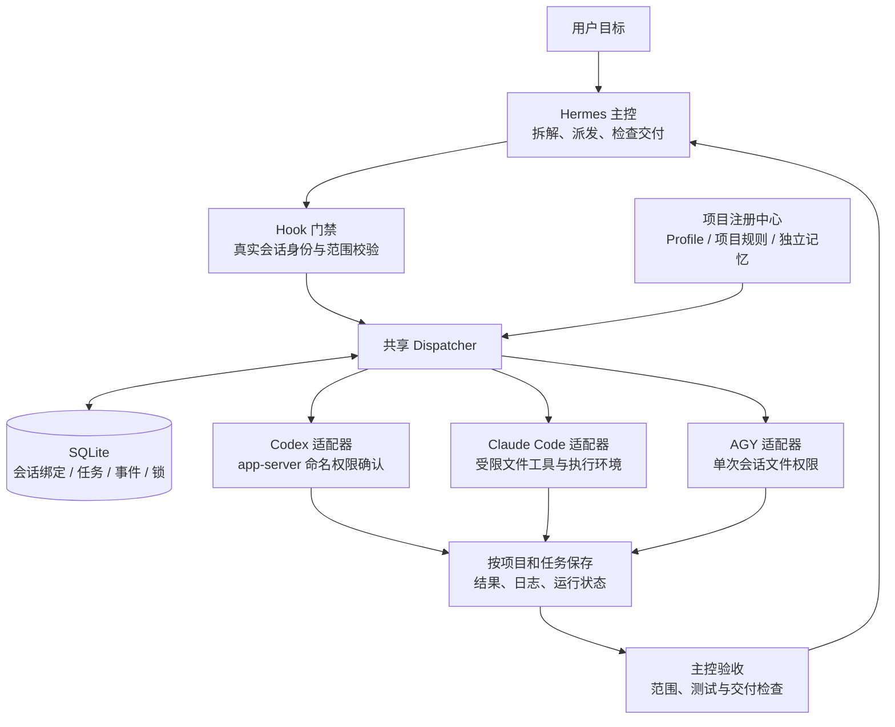

# Hermes Team V8

**一套 Hermes，管理多个项目，协调多个 Agent 执行器。**

基于 Hermes 搭建的 Windows 本地 Agent 编排实践：由 Hermes 理解目标、拆分任务、派发执行并检查交付，通过共享 Dispatcher 将 Codex、Claude Code 和 Antigravity CLI（AGY）接入同一套任务协议。

V8 的重点是让多个项目共用工具和登录状态，同时明确每次任务属于哪个项目、能访问哪些文件、如何停止，以及用什么证据判断结果。

> 这是项目总结与架构展示仓库，包含脱敏示例，不包含可安装的完整实现。V8 是本地编排方案的版本名，并非上游 Hermes 的官方版本号。整理日期：2026-11-17。

[架构与执行流程](docs/architecture.md) · [验证记录与边界](docs/validation.md) · [版本演进](CHANGELOG.md) · [配置示例](examples/)

## 为什么做这个项目

同时推进网站、3D 创作和自动化项目时，直接在一个长对话里调用多个 CLI，会遇到几类实际问题：

- 项目上下文与历史记录混用，任务容易读到不属于自己的文件。
- 不同执行器的命令、权限和结果格式不同，不能只看退出码就判定成功。
- 重复提交、任务超时或进程中断，可能影响提示文件、执行锁和后续任务。
- 主控频繁查询状态、反复读取长日志，增加模型调用与上下文负担。

V8 将这些问题收敛到项目注册、会话绑定、任务协议、执行器适配和证据记录几个明确的边界中。

## 整体架构

三个执行器共享调度协议，**当前所有 Worker 任务串行执行，包括只读任务**。多个执行器的接入不代表它们同时运行；占锁时启动会被拒绝，尚未实现自动排队调度。

## 核心能力

| 能力 | 实现方式 | 解决的问题 |
|---|---|---|
| 单实例管理多个项目 | 注册中心维护项目 ID、根目录、状态和执行器白名单 | 集中管理项目入口与可执行范围 |
| 会话绑定项目 | SQLite 保存 `session_id → project_id` | 不同对话独立选择项目 |
| 项目上下文与记忆 | 加载当前项目规则、Profile、decisions 和 progress，并限制读取大小 | 减少跨项目上下文混用 |
| 统一任务协议 | 校验项目、执行器、任务类型、风险、执行模式与幂等键 | 在调用 CLI 前拒绝不完整或越界任务 |
| 提示快照保护 | 写事务内查重、独占创建文件、保存 SHA-256、执行前复核 | 避免重复请求覆盖已有任务内容 |
| 权限与路径约束 | Hook、目录校验与执行器权限策略共同限制访问 | 阻止已覆盖场景中的跨项目读写与控制面访问 |
| 进程生命周期管理 | Windows Job Objects 管理任务进程树，处理取消、超时与清理 | 降低遗留子进程和错误释放锁的风险 |
| 可追溯的执行证据 | SQLite 任务事件、独立 stdout/stderr 和 JSON 结果 | 查询失败原因并复核任务过程 |
| 有界状态查询 | 本地最多等待 30 秒；运行中返回简短状态，终态保留有限日志尾部 | 减少高频模型轮询与重复日志回传 |

## 三种执行器如何接入

| 执行器 | V8 的接入方式 | 当前边界 |
|---|---|---|
| Codex | 使用本机 `app-server` 的单任务适配器，提交模型任务前检查服务确认的 `hermes_v8` 权限配置 | 拒绝错误权限配置和危险回退；适配器与已验收的 CLI 协议相关 |
| Claude Code | 复用原登录，配置 restricted、明确文件工具列表，并通过受限执行层约束范围 | 当前适配器开放受限文件操作，不能据 CLI 名称推断底层模型或审查独立性 |
| Antigravity CLI（AGY） | 每次调用通过 `--settings` 传入当前项目的文件访问规则 | 禁止终端、MCP 和浏览器工具；只读任务同时禁止写文件 |

登录和模型服务由本机环境提供；执行器接入不代表模型调用免费。构建、测试等操作需要分配给具备相应权限的执行器。

## 一次任务如何流转

1. **进入项目**：将当前会话绑定到已启用项目，读取对应上下文和进度。
2. **创建任务**：校验任务字段与会话归属，生成独立提示快照，记录初始状态和事件。
3. **Dry run**：检查策略、执行参数和授权条件；高风险任务需要相应审批状态。
4. **执行**：取得锁后启动受控 Worker，持续保存输出并检查超时、取消和进程状态。
5. **观察与清理**：查询简短状态，确认任务进程树停止，再处理锁和结果。
6. **验收交付**：主控根据任务标准复核改动、测试和可见成果。

**`SUCCEEDED` 表示执行层成功完成，产品效果与视觉质量仍需单独验收。**

在已配置好的本地 Hermes 中，可以用自然语言进入项目，例如：“进入网站项目，先告诉我当前进度。”进入项目只绑定会话并加载上下文，不会自动续跑旧任务。

脱敏后的 [项目注册示例](examples/registry.example.json) 和 [任务示例](examples/task.example.json) 用于说明数据结构；本仓库不提供安装或执行这些命令所需的运行时。

## 验证情况

| 检查 | 日期 | 结果与范围 |
|---|---|---|
| V8 初次本地回归 | 2026-11-11 | 69 项通过；覆盖项目绑定、迁移、提示保护、锁、路径和执行器适配等 |
| 真实执行器与边界验收 | 2026-11-11 | 本机验收记录包含三个执行器的成功调用，以及独立测试项目中的访问边界检查 |
| 状态查询优化后回归 | 2026-11-11 | 76 项通过，其中新增 7 项状态摘要检查 |
| 本次整理时的本地回归 | 2026-11-17 | 76 项全部通过，用时 24.767 秒；见 [验证记录](docs/validation.md) 和 [测试摘要](evidence/test-summary.json) |

历史在线验收与本次本地回归分别记录。本次不将离线测试视为当前在线模型、账号或 CLI 兼容性已全部通过的证明。

## 工程取舍

- **先保证归属和停止行为，再扩展吞吐量。** 当前使用全局串行策略和项目锁，牺牲并发速度以降低多执行器竞争复杂度。
- **复用工具，补齐协议。** 继续使用已有 CLI 和登录；项目边界、任务生命周期及结果解析由编排层负责。
- **完整证据留在文件，主控读取摘要。** 缩短重复状态输出，同时保留详细日志供排查；尚无真实成本对比来量化节省比例。
- **保留历史数据。** V8 以增加字段和映射归属的方式迁移账本；初次迁移验收保留了 80 条任务和 4,258 条事件。这些数字是迁移完整性样本，不是成功交付数量。

## 当前限制与后续方向

- 目前是面向 Windows 本地环境的编排实践，尚未提供通用安装器、完整源码包或跨平台验收。
- 初次验收后曾出现一次 Codex JSON-RPC 编码错误及 90 秒超时，原因未确定；后续状态查询优化不能作为该问题已修复的证据。
- 命名权限协议、执行器版本、Hook 和本机配置共同影响边界行为；CLI 升级需要重新验收。
- 当前隔离针对项目与控制面的既定边界，不能据有限测试推导出完整主机隔离或网络数据防泄漏能力。
- 小样本验收、主动汇报和阶段预算包含行为规则，尚未全部转化为程序强制关卡；质量提升与实际 Token 节省仍需真实任务对照。
- 后续优先补充兼容性回归、失败样本与可复现基准，再评估源码整理、安装方式及并发调度。

## 技术组成

**Python 标准库 · SQLite · Windows Job Objects / ctypes · JSON / TOML · Hermes Hooks / Skills · Codex app-server · Claude Code CLI · Antigravity CLI**

仓库公开的是经整理的架构说明、验证摘要和虚构配置示例；账号信息、私有配置、业务文件、聊天数据库与原始运行日志保留在本地。
