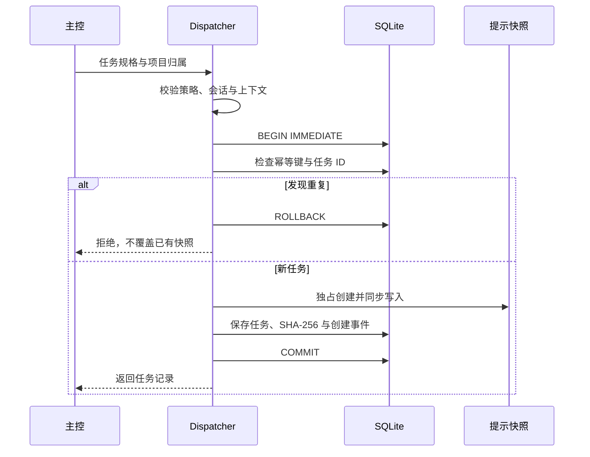

# 架构与执行流程

## 设计目标

用一套 Hermes 和一份共享 Dispatcher 管理多个项目，同时让任务归属、执行权限、生命周期和交付证据可以单独核对。

本文描述 2026-11-17 检查到的本地实现。模块名对应本地源码，完整实现未随本展示仓库发布。

## 模块划分

| 模块 | 职责 |
|---|---|
| `dispatcher.py` | 创建任务、dry run、后台启动、状态摘要、取消、事件和锁管理 |
| `policy.py` | 校验任务、项目及执行器白名单，检查风险和执行模式，构造 CLI 调用 |
| `project_manager.py` | 注册中心、会话绑定、项目上下文、迁移、路径校验和 Worker 权限适配 |
| `codex_worker.py` | 本机 Codex app-server 的单次任务协议适配与权限确认 |
| `process_runtime.py` | 进程身份、Windows Job Objects、输出流保存、超时和取消 |
| `team-policy.py` | Hermes Hook 门禁，约束主控工具调用与项目归属 |
| `projects/` | 项目注册、Profile、独立记忆和新项目模板 |
| `team-project-manager` Skill | 指导 Hermes 使用项目入口和共享 Dispatcher |

## 项目归属与上下文

注册中心保存稳定的 `project_id`、本地根目录、项目状态以及允许的执行器。执行时还需匹配 routing 白名单。未知、未启用、根目录不匹配或重叠的项目不能直接进入执行路径。

会话绑定保存在 `session_projects` 表中。每个会话独立选择项目，切换一个会话的绑定不会改写其他会话的选择；实现不依赖全局可变的 `current_project`。

任务创建时核对 `session_id` 与 `project_id`。在 Hermes 的受控入口中，Hook 从运行时补全真实会话身份并再次校验，避免把模型填写的会话 ID 当作可信身份。普通终端直接调用不经过这层 Hook，不能用于证明 Hook 隔离效果。

项目上下文按范围读取：

- 当前项目 Profile。
- 项目根目录中的 `AGENTS.md`、`CLAUDE.md`、`PROJECT.md`。
- 项目 `docs/decisions.md` 与 `docs/progress.md`。
- 共享管理目录中按 `project_id` 分隔的 decisions / progress 记忆。

读取有字节上限。会话绑定不会清除既有聊天内容，因此不同项目仍推荐使用不同会话；这也说明文件范围控制与模型上下文管理是两种不同的机制。

## 任务持久化与提示保护

核心数据包括 `tasks`、`task_events`、`project_locks`、`session_projects`。结果 JSON、提示快照和 stdout/stderr 文件与数据库中的任务 ID 对应。

创建任务的关键顺序是：

数据库约束与文件独占创建共同保护重复请求。异常清理只删除本次新建的快照；执行前再次检查快照路径、归属和哈希。该机制针对已覆盖的覆盖和篡改场景，不构成通用恶意管理员防护。

## 状态与执行锁

任务状态包括 `CREATED`、`AWAITING_APPROVAL`、`DRY_RUN`、`QUEUED`、`RUNNING`、`SUCCEEDED`、`FAILED`、`BLOCKED` 和 `CANCELLED`。

当前采用 `serial_all_workers` 策略，所有执行任务串行，同时保留项目独占锁。`QUEUED` 是后台启动流程中的状态，不表示已经实现自动队列、公平调度或并行资源池。遇到占锁会拒绝启动，需要等待并处理新的执行请求。

执行期间保存进程 PID 与启动身份，避免仅按 PID 推断进程归属。Windows 子进程先以挂起方式创建，纳入带 kill-on-close 的 Job Object 后恢复运行。取消和超时作用于所属进程树；不能确认清理完成时保留锁，避免后续写者与残留进程重叠。

## 权限分层

| 层 | 控制内容 |
|---|---|
| 注册与任务策略 | 项目 ID、根目录、允许的执行器、任务类型、风险下限和执行模式 |
| 主控 Hook | 窄命令入口、真实会话身份、跨项目任务与文件访问、主控写入范围 |
| 文件路径校验 | 路径穿越、含糊 Windows 路径、链接 / reparse point 与已有硬链接等检查 |
| 执行器适配 | Codex 命名权限确认、Claude 受限工具和执行层、AGY 单次调用文件权限 |
| 生命周期管理 | 全局串行、项目锁、取消、超时、进程树清理和结果保存 |

Codex 在服务确认预期的命名权限配置、且未退回危险权限后才提交模型任务。当前适配器关闭该入口中的全局记忆、外部 MCP / Apps 和通知回调，并将任务运行状态及日志按项目保存。

AGY 当前禁止终端、MCP 和浏览器工具。某个任务名称出现在路由表中，并不代表对应执行器具备该工具能力；主控必须结合实际适配器权限选择执行者。

这些边界依赖本机配置、受信任 Hook、CLI 版本和 Windows 执行层。部分执行路径保留网络访问，不应将项目文件隔离描述为完整网络沙箱。

## 状态摘要与验收

`task_status_summary` 在本地等待状态变化，最长 30 秒。等待只查询本地状态，不向模型发起新的请求，也不修改任务、审批或锁。

运行中的摘要返回任务字段、日志路径和字节数；终态摘要保留每条日志最多 512 字符尾部、错误信息最多 800 字符。完整日志与详细检查接口继续保留。

输出标记 `execution_status_only`，明确执行状态的含义。代码测试、浏览器检查和视觉验收仍需要各自的证据；状态摘要本身不能代替这些检查。
