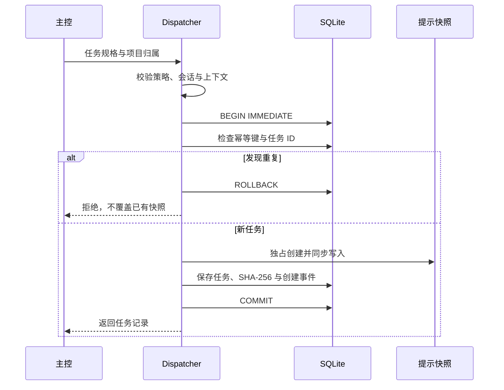

# 架构与执行流程

## 设计目标

用一套 Hermes 和一份共享 Dispatcher 管理多个项目，同时让任务归属、执行权限、生命周期和交付证据可以单独核对。

本文描述 2026-11-17 安装并验收的本地 V8.1 实现。模块名对应本地源码，完整实现未随本展示仓库发布。

## 模块划分

| 模块 | 职责 |
|---|---|
| `dispatcher.py` | 创建任务、dry run、后台启动、状态摘要、取消、事件和锁管理 |
| `policy.py` | 校验任务、项目及执行器白名单，检查风险和执行模式，构造 CLI 调用 |
| `project_manager.py` | 注册中心、会话绑定、项目上下文、迁移、路径校验和 Worker 权限适配 |
| `codex_worker.py` | 本机 Codex app-server 的单次任务协议适配与权限确认 |
| `process_runtime.py` | 进程身份、Windows Job Objects、输出流保存、超时和取消 |
| `workflow.py` | 加法迁移、明确队列、同项目依赖、独立验收、预算与用量、CLI 诊断 |
| `team-policy.py` | Hermes Hook 门禁，约束主控工具调用与项目归属 |
| `projects/` | 项目注册、Profile、独立记忆和新项目模板 |
| `team-project-manager` Skill | 指导 Hermes 使用项目入口和共享 Dispatcher |

## 项目归属与上下文

注册中心保存稳定的 `project_id`、本地根目录、项目状态以及允许的执行器。执行时还需匹配 routing 白名单。未知、未启用、根目录不匹配或重叠的项目不能直接进入执行路径。

会话绑定保存在 `session_projects` 表中。每个会话独立选择项目，切换一个会话的绑定不会改写其他会话的选择；实现不依赖全局可变的 `current_project`。

任务创建时核对 `session_id` 与 `project_id`。在 Hermes 的受控入口中，Hook 从运行时补全真实会话身份并再次校验，避免把模型填写的会话 ID 当作可信身份。普通终端直接调用不经过这层 Hook，不能用于证明 Hook 隔离效果。

项目上下文按范围读取：

- 当前项目 Profile。
- 项目根目录中的 `AGENTS.md`、`CLAUDE.md`、`PROJECT.md`。
- 项目 `docs/decisions.md` 与 `docs/progress.md`。
- 共享管理目录中按 `project_id` 分隔的 decisions / progress 记忆。

读取有字节上限。会话绑定不会清除既有聊天内容，因此不同项目仍推荐使用不同会话；这也说明文件范围控制与模型上下文管理是两种不同的机制。

## 任务持久化与提示保护

核心数据包括 `tasks`、`task_events`、`project_locks`、`session_projects`。结果 JSON、提示快照和 stdout/stderr 文件与数据库中的任务 ID 对应。

V8.1 通过增加 `task_options`、`task_dependencies`、`task_reviews`、`task_queue`、`task_usage`、`adapter_checks` 和 `queue_watch` 保存工作流元数据。迁移不将已有任务自动加入队列。

创建任务的关键顺序是：

数据库约束与文件独占创建共同保护重复请求。异常清理只删除本次新建的快照；执行前再次检查快照路径、归属和哈希。该机制针对已覆盖的覆盖和篡改场景，不构成通用恶意管理员防护。

## 状态与执行锁

任务状态包括 `CREATED`、`AWAITING_APPROVAL`、`DRY_RUN`、`QUEUED`、`RUNNING`、`SUCCEEDED`、`FAILED`、`BLOCKED` 和 `CANCELLED`。

当前继续采用 `serial_all_workers` 策略，所有执行任务串行，同时保留项目独占锁。V8.1 为明确提交的任务增加独立队列表：`WAITING`、`DISPATCHING`、`RUNNING`、`DONE`、`BLOCKED`、`CANCELLED`。主任务仍使用原有状态，队列不是并行资源池或跨用户公平调度系统。

`enqueue` 明确授权任务等待执行；`run` 在 V8 项目模式下排队并尝试启动，资源忙时保留等待。单一后台观察进程在本地等待资源和接续工作，不通过模型轮询。观察进程单次最多一小时，之后可用 `run-next` 恢复。只有明确加入队列的任务会自动接续。

依赖最多 16 个，只能引用已存在的同项目任务，创建后不可改写。前置任务须执行 `SUCCEEDED` 且验收 `ACCEPTED`；失败、取消或拒绝会阻塞依赖任务。依赖只指向创建时已有任务，避免引入循环和前向引用。

目录审计、原生权限和 CLI 准备在 SQLite 写事务外完成，提交前重查任务身份、授权和依赖。资源等待只释放匹配 token 的预留，过期 Worker 不得改变取消任务的队列状态。

执行期间保存进程 PID 与启动身份，避免仅按 PID 推断进程归属。Windows 子进程先以挂起方式创建，纳入带 kill-on-close 的 Job Object 后恢复运行。取消和超时作用于所属进程树；不能确认清理完成时保留锁，避免后续写者与残留进程重叠。

## 权限分层

| 层 | 控制内容 |
|---|---|
| 注册与任务策略 | 项目 ID、根目录、允许的执行器、任务类型、风险下限和执行模式 |
| 主控 Hook | 窄命令入口、真实会话身份、跨项目任务与文件访问、主控写入范围 |
| 文件路径校验 | 路径穿越、含糊 Windows 路径、链接 / reparse point 与已有硬链接等检查 |
| 执行器适配 | Codex 命名权限确认、Claude 受限工具和执行层、AGY 单次调用文件权限 |
| 生命周期管理 | 全局串行、项目锁、取消、超时、进程树清理和结果保存 |

Codex 在服务确认预期的命名权限配置、且未退回危险权限后才提交模型任务。当前适配器关闭该入口中的全局记忆、外部 MCP / Apps 和通知回调，并将任务运行状态及日志按项目保存。

AGY 当前禁止终端、MCP 和浏览器工具。某个任务名称出现在路由表中，并不代表对应执行器具备该工具能力；主控必须结合实际适配器权限选择执行者。

AGY 提示编码为单条 `stream-json` user 消息经标准输入发送，换行及 JSON 文本保留为消息内容，不能注入第二轮任务。最终 Windows 命令仍做参数长度检查。`browser_verify` 默认路由到 Codex。

这些边界依赖本机配置、受信任 Hook、CLI 版本和 Windows 执行层。部分执行路径保留网络访问，不应将项目文件隔离描述为完整网络沙箱。

## 状态摘要与验收

`task_status_summary` 在本地等待状态变化，最长 30 秒。等待只查询本地状态，不向模型发起新的请求，也不修改任务、审批或锁。

运行中的摘要返回任务字段、日志路径和字节数；终态摘要保留每条日志最多 512 字符尾部、错误信息最多 800 字符。完整日志与详细检查接口继续保留。

输出标记 `execution_status_only`，明确执行状态的含义。代码测试、浏览器检查和视觉验收仍需要各自的证据；状态摘要本身不能代替这些检查。

V8.1 的 `review` 保存独立的接受 / 拒绝决定和证据摘要、路径、SHA-256。决定不可改写，返工创建新任务。证据文件须在当前项目内且不超过 64 KiB；至少一项命名检查，接受时全部为 passed；写任务至少一个实际存在的项目输出文件。程序校验证据完整性，不证明测试真实执行或产品质量达标。

## 预算与兼容性诊断

默认累计 stdout / stderr 日志预算为 16 MiB，可配置 1 KiB 到 64 MiB；单流结构化结果解析仍限制在 4 MiB。可选 Token 阈值按执行器上报量判断，超限停止所属进程树；延迟上报不保证账单上限，未上报用量明确标为不可用。缓存 Token 单列记录，默认不自动重试。

`doctor` 记录三个 CLI 的版本和版本变化；`doctor --probe` 额外做 Codex 原生命名权限握手，不创建模型 turn。握手成功仅验证该握手路径，CLI 更新后仍需小任务与完整文件边界复测。
